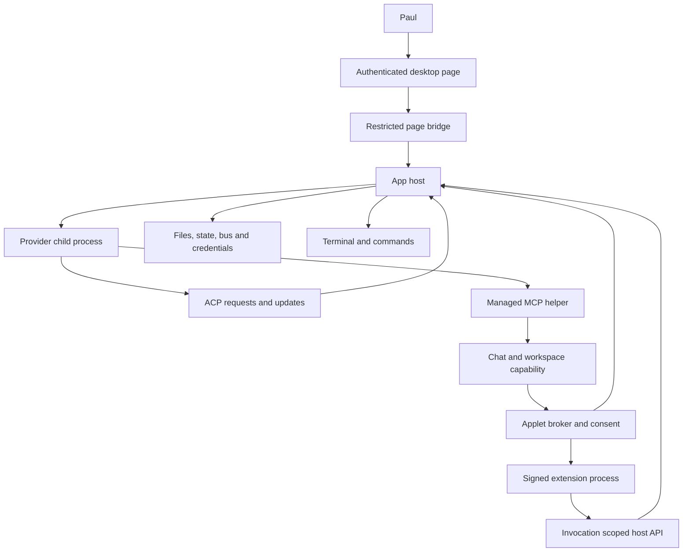

# Dinah trust boundaries

This is the Phase 1 threat model for master `4a345880891acf7489bfbea2b66e36dfcd56151d`, prepared on 2 November 2026 under `docs/plans/review-2026-11.md`. Source inspection used an isolated worktree at that commit. The review changed documentation only. It did not run providers, extensions, terminals, notifications, application servers or desktop automation, inspect live credentials, or restart anything. File and line references below refer to this commit.

The model follows the shared Architectural Principles at `C:\Users\paul\OneDrive\Documents\Architectural Principles.md`. It records the implementation's current authority boundaries rather than assuming that every interface has the same confinement. Phase 2 must test the residual risks; this document does not certify the application secure. Quality owns the green baseline, and Release owns dependency and build provenance. No review fix is claimed here.

## Assets, principals and assumptions

Dinah must protect Paul's files, credentials, approval settings, private conversations, provider sessions, delivery ownership and installed executable code. Availability matters because a stalled broker or corrupted state can prevent Paul from receiving or acting on work.

Paul is the authority for configuration, trusted workspace links, installation, approval modes and destructive actions. The authenticated desktop page has broad application authority. A provider executable and a native extension executable run locally as child processes; their API permissions do not make them operating-system sandboxes. Model output, tool output, repository files, attachment bytes, extension UI messages and other agents' prose remain potentially hostile content, even when a request arrived through an authenticated channel.

A hostile web page is outside the loopback HTTP boundary. A process already executing as Paul's OS user is a stronger adversary: loopback binding and Go file modes alone do not establish isolation from it. This review has not inspected effective Windows ACLs, browser profiles or Credential Manager access policy. A child-process lifetime job is not treated as an access-control boundary.

Trust in another workspace authorizes requests according to Paul's link policy. It does not establish the truth of that agent's claims or make its attachments safe. Applet bearer context identifies a chat/workspace channel, not a human approval of every action. The code refreshes a channel's expiry when supplying context; it does not mint a new one-use capability for every model turn (`cmd/dinah-desktop/applet_mcp.go:178`).

## Authority paths

The arrows describe authority transfer. They do not imply that the processes at either end are isolated from the host filesystem. The extension frontend has an additional sandbox boundary described below.

## 1. Bus messages and trusted workspace links

**Trusted principal and input.** The bus trusts its locally bound sender identity and Paul's configured workspace links. It receives message text, recipient/group selections, attachment references, reply IDs and requested action recipients. Another agent can send misleading instructions, spoof authority in message bodies, disclose attached information or generate repeated work.

**Current code.** Workspace pairs and their hop limits are stored transactionally (`internal/bus/links.go:45`). Trust is computed from the database, not parsed from body text (`internal/bus/links.go:116`). Delivery selects pending recipient rows inside a transaction and applies group/hop policy (`internal/bus/bus.go:859`). The formatted prompt adds the trusted-link statement only from message metadata and distinguishes captured completion output from the person's instructions (`internal/bus/format.go:73`). Window-managed MCP binds its bus identity at construction (`internal/mcpserver/server.go:132`). Trust mutation is exposed to the authenticated page as `BusTrust`/`BusUntrust` (`cmd/dinah-desktop/page_api.go:65`); the MCP tool rules are explanatory policy, not an executable authorization checker.

**Residual risk and guard.** Prompt-injection resistance still depends on the agent respecting the host-supplied provenance. A sender may request work from a linked workspace, but text must not grant a new capability. Phase 2 should trace each sender-binding route and prove that an untrusted message cannot forge the trusted metadata. The guard should send identical hostile text over trusted and untrusted links, assert different metadata, and verify recipient ownership through recovery and replay. Trust changes must remain absent from agent-accessible tool registration.

## 2. Applet context, managed MCP ingress and broker

**Trusted principal and input.** The host creates the capability; an agent possesses it for a bound channel. Inputs include action references, schema digest, exact JSON arguments, request ID, deadlines, invocation IDs and artifact IDs. A stolen capability could exercise that channel's available actions or inspect its results. Replayed or altered requests could otherwise repeat effects or cross chat ownership.

**Current code.** The applet server binds IPv4 loopback on an ephemeral port, creates random instance/channel tokens and registers trace redactions (`cmd/dinah-desktop/applet_mcp.go:65`). The helper resolves the capability through a host-created descriptor with strict component syntax; it does not accept an arbitrary model-supplied endpoint (`:125`). HTTP requires exact host/path/method, no browser Origin or Sec-Fetch-Site, JSON, a live bearer token and bound ownership for operations beyond discovery (`:268`). It limits request bytes, headers, time and concurrent bridge operations. Revocation is rechecked while accepting the operation (`:324`). Owner/workspace are derived from the channel, not supplied in action JSON (`:341`). Stable request IDs bind retries to the same exact action/digest/input/deadline. MCP admission has a separate wire-level limiter (`cmd/dinah-desktop/applet_mcp_admission.go:30`).

The broker checks registry digest, capabilities and input schema before persisting an invocation (`internal/applet/broker/broker.go:260`). It serializes records and uses durable process ownership. Owner checks apply to get/cancel/artifact operations (`:531`, `:602`, `:807`). Output validation and SVG artifact validation occur before accepting results (`:455`). Agent operations cannot answer a human request through this dispatch switch; the person-facing answer route is separate (`cmd/dinah-desktop/applet_host.go:140`).

**Residual risk and guard.** Capability theft within the local user or provider process remains in scope as a trust assumption, not prevented by loopback alone. Context expiry is channel based and extended to 24 hours. The guard set should preserve wrong-owner, revoked-generation, expired-channel, stale-digest, exact-input retry and human-answer denial cases. Existing anchors include `TestAppletBridgeOwnershipAndLifecycle`, `TestAppletBridgeRequestBoundary`, `TestAppletManagedContextIsolationAndExpiry` and `TestAppletMCPAdmissionThroughWire`; their current pass status belongs to Quality's baseline, not this inspection.

## 3. Action effect declarations and human consent

**Trusted principal and input.** The person authorizes approval modes and workspace grants. Bundle authors declare capabilities and effect levels. A malicious or mistaken declaration could label an effectful action as a read or reversible local change and avoid an expected prompt.

**Current code.** `Effectful` classifies capabilities, while an explicit `read` or `local` effect suppresses asking and `history`/`network` asks (`internal/applet/registry.go:37`, `:51`). `appletConsent` applies only to chat-owned invocations and actions whose declaration asks. It bypasses prompts under Approve Everything, workspace grants or provider unattended mode, otherwise asks through the permission service and persists an Always Allow grant (`cmd/dinah-desktop/applet_consent.go:37`). The broker calls consent before invoking the action (`internal/applet/broker/broker.go:397`).

**Residual risk and guard.** Effect labels are executable security policy, not presentation hints. Registry/schema validation does not establish that an implementation's effects match its label. Phase 2 must inventory declarations against handlers and signed extension permissions. A static declaration matrix and tests for each approval-mode/effect combination should guard the chosen policy. Changes to Paul's unattended behavior need a decision, not an unannounced tightening during this phase.

## 4. Provider tool calls and approval responses

**Trusted principal and input.** An installed/configured provider sends ACP permission requests with its own tool descriptions and option IDs. Dinah returns the selected outcome; the provider performs its tools. Hostile descriptions could deceive the person, and forged or late responses could authorize another pending operation.

**Current code.** The handler parses permission requests, redacts applet context, attributes supported subagent requests and routes them to host permission waiters (`internal/sessionhost/handler.go:234`). The waiters have host-generated keys, preserve pending cards, clear on completion/cancellation and return cancelled when the context ends (`internal/sessionhost/permissions.go:82`, `:94`, `:133`). Host wiring is in `cmd/dinah-desktop/agent_handler.go:15`. The page's `Answer` operation has whole-application authority through the restricted page bridge, not a model-readable applet route (`cmd/dinah-desktop/page_api.go:65`).

**Residual risk and guard.** A request's tool description is provider content. The permission service is not an independent execution monitor for a compromised provider, nor proof that the provider obeys the selected option. Phase 2 should verify that accepted option IDs are among those offered, that late keys cannot target replacement questions, and that provider/session attribution cannot be changed by another connection's JSON. Guards should cover unknown options, cancellation, subagent attribution and response replay.

## 5. ACP transport and session attribution

**Trusted principal and input.** Dinah starts a configured executable, then consumes newline-delimited protocol responses, reverse requests, session updates and stderr. A faulty or hostile adapter can report forged session IDs, send oversized frames, flood requests or leak secrets into diagnostics.

**Current code.** ACP starts a hidden child with configured cwd/environment, inherits environment when no override is supplied and marks it hosted (`internal/acp/conn.go:152`). Input frames are bounded at 64 MiB; malformed lines are skipped with a diagnostic, request messages start a goroutine, and replies are correlated against pending numeric IDs (`:310`). Trace secrets and redactors are registered separately (`:378`). Handler dispatch uses the provider-supplied session ID to select conversation/subagent state; judge sessions have an explicit refusal path (`internal/sessionhost/handler.go:234`).

**Residual risk and guard.** A handler per connection does not by itself prove per-session ownership validation. Request concurrency is not bounded at the read loop. Source inspection establishes these properties but does not establish a cross-provider exploit. Guards should exercise spoofed session IDs, retired provider generations, bounded concurrent reverse requests and allocation under maximum-sized frames. No transport mutation was made here.

## 6. Managed and external MCP egress

**Trusted principal and input.** The host configures managed servers; provider/user configuration may supply other MCP servers. Tool schemas, descriptions, results and resources returned by those servers are untrusted data. A server executable is also local code with inherited OS access.

**Current code.** The desktop constructs its managed helper using the current executable and explicit state directory (`cmd/dinah-desktop/providers.go:331`). Bus servers bind a preselected launched/window session or learn an identity through their hook path (`internal/mcpserver/server.go:125`, `:612`). Ollama accepts only command/stdio server declarations and validates server names (`internal/ollamaagent/applets.go:33`); child commands receive environment plus configured overrides (`internal/ollamaagent/process.go:60`). Its MCP connection uses `MaxLineLength: -1` (`:110`), so this path does not share ACP's 64 MiB frame bound. Codex merges managed server configuration into its native configuration path (`internal/codexagent/session.go:299`). Native extension MCP is separately constrained by the signed manifest, as described below.

**Residual risk and guard.** Dinah's managed capabilities must not imply trust in every MCP result or constrain the provider's independently configured plugins. Audit all user-configured server launch/config merge routes and output-size limits in Phase 2. Guards should preserve managed-name ownership, reject unsupported transports and bound a malicious server's response. This is a distinct boundary from inbound applet bearer authorization.

Model-service traffic crosses another boundary. Prompts, attached context and tool results can leave the machine through the selected provider. Dinah delegates native-provider network/authentication behavior to that executable; it cannot infer confidentiality from a local ACP pipe. Ollama's HTTP client accepts its configured base and uses a standard HTTP client (`internal/ollamaagent/api.go:55`). Phase 2 should inventory endpoint configuration, redirect behavior, payload limits and request deadlines, then use fake remote endpoints as guards. This inventory did not contact a model service or inspect account tokens.

## 7. Desktop WebView, page bridge and external navigation

**Trusted principal and input.** The authenticated desktop page can invoke broad file, provider, approval, terminal and configuration methods. Hostile chat/document/extension strings must never become page script or an authenticated bridge caller.

**Current code.** Wails serves a small bootstrap that obtains a one-time entry URL for the loopback shell (`cmd/dinah-desktop/main.go:166`). The shell uses exact host checks, a random HttpOnly SameSite=Strict cookie, same-origin checks for mutations, CSP and no-store headers (`cmd/dinah-desktop/shell_server.go:124`, `:185`). The exposed method inventory is explicit and fails construction for an invalid inventory (`cmd/dinah-desktop/page_api.go:27`, `:111`). The bridge validates callable signatures/arguments and restricts methods (`internal/bridge/bridge.go:124`, `:213`); HTTP calls are capped at 64 MiB (`:406`). The shell adds clipboard, browser-open and quit runtime operations (`cmd/dinah-desktop/shell_server.go:62`). Extension assets and shared SDK/PUDL assets have deliberate pre-cookie routes and their own handling (`:138`).

**Residual risk and guard.** Same-origin script compromise would inherit the page's broad authority. CSP is defense in depth, not a substitute for escaping and URL validation. Front End owns sink-by-sink markup, iframe and message-event review. Engine must preserve a closed method inventory, authentication for bridge/events/uploads/file routes, Origin/Host denial and entry-code single use. `TestShellPageHasContentSecurityPolicy` and the page-method inventory test are existing anchors, not complete XSS coverage.

## 8. Workspace resources, file access and attachments

**Trusted principal and input.** The person attaches source roots and selects files. Agents and source providers supply relative paths, stable resource references, document content and attachment bytes. Risks include traversal, symlink replacement, stale resource identity, destructive overwrite and content being executed when rendered.

**Current code.** Applet workspace scope comes from the invocation context, and registered workspace/source identity is host resolved (`cmd/dinah-desktop/applet_workspace.go:24`; `applet_workspace_resources.go:20`). Resource actions use schemas with bounded paths/pages and explicitly label returned text untrusted. The local provider rejects absolute paths, colon/backslash/NUL, parent/hidden components and noncanonical segments (`internal/resource/localfs/localfs.go:286`). It opens roots, checks ancestors and bounds UTF-8 text reads to 1 MiB (`:324`, `:369`, `:380`). The generic resource FS validates fs paths and delegates confinement to the provider (`internal/resource/fs.go:20`). Bus person-file attachments are capped at 25 MiB, renamed safely, copied without overwriting and hashed (`internal/bus/attachments.go:29`, `:74`, `:113`).

ACP file callbacks are a different authority path. `fs/read_text_file` calls `os.ReadFile` on the requested path before line slicing, with no local size limit or workspace selection there (`internal/sessionhost/handler.go:266`). Writes use protected-path policy and managed-root confinement but otherwise depend on provider approval behavior (`internal/agents/files.go:16`, `:36`; `cmd/dinah-desktop/agent_handler.go:35`). Ollama has its own configurable file scope using open roots when limited (`internal/ollamaagent/files.go:17`, `:55`). These paths must not be described as universally workspace confined.

**Residual risk and guard.** Agent-native shell tools can also reach OS files under their provider's permissions, outside these APIs. Phase 2 should explicitly settle host-mediated read scope and size policy, check protected-setting paths through symlinks on unmanaged roots, and verify resource/attachment authorization at each serving route. Guards should use temporary outside-root sentinel files, swapped symlinks, stale source IDs and oversized reads. No live file access was used to test an escape.

## 9. PTY, Terminal and command execution

**Trusted principal and input.** An authenticated page action or approved extension command selects a program, arguments, folder and terminal input. Shell output is arbitrary binary/escape-sequence data. A terminal command has the OS user's authority and can start further programs, read credentials or reach the network.

**Current code.** The page calls a shared terminal service after resolving a resource-aware folder (`cmd/dinah-desktop/terminal_shells.go:146`). The service starts known shells or an already-authorized executable, registers random terminal IDs, enforces shutdown admission and streams output as base64 (`internal/terminals/service.go:86`, `:103`, `:115`, `:181`). Input/resize/close are addressed by terminal ID (`:240`). Extension terminal starts use a prepared ticket before reaching StartCommand (`cmd/dinah-desktop/extensions.go:210`). These IDs route work; they are not per-agent filesystem sandboxes.

**Residual risk and guard.** Shell parsing is intentional after the user authorizes a shell command. The review must distinguish argv commands from strings evaluated by PowerShell or /bin/sh (`internal/ollamaagent/tools.go:556`). Front End should check terminal hyperlink/escape handling without granting output a host command path. Guards should verify workspace resolution, ticket consumption, argument boundaries, bounded dimensions/input where applicable, shutdown admission and handling of hostile terminal output. No terminal was started for this inventory.

## 10. Native extension installation, MCP and host callbacks

**Trusted principal and input.** The person enables an installed signed extension. The extension supplies manifests, schemas, asset bytes, action results and callback requests. A signature establishes package integrity under its signer policy; it does not make native code safe.

**Current code.** The manager verifies the enabled installation and signature before execution (`internal/extensions/manager.go:135`), starts the platform backend with a filtered environment and compares MCP tools/schemas/action metadata with the signed manifest (`:210`, `:237`, `:249`). Each call gets a random scope token bound to workspace, permissions, extension ID and context, removed on completion (`:337`). Callback HTTP requires loopback/exact Host, no browser Origin, valid scope, bounded strict JSON, and per-tool permissions (`internal/extensions/host.go:125`, `:175`, `:181`). Host file access uses open roots and expected hashes; host.run checks executable permission, cwd, argument/input/output bounds, timeout and optional command review (`:58`, `:97`, `:188`, `:326`).

**Residual risk and guard.** Native backend code can bypass those host callbacks by making its own OS calls. Environment filtering removes DINAH-prefixed, API_KEY and _TOKEN variables but is not a complete secret allowlist (`internal/extensions/manager.go:237`). The process job controls lifetime, not file/network access. Phase 2 must separate installation trust from callback authorization and review signer admission in the extension library, whose supply chain belongs to Release. Guards should reject changed signatures/tool schemas, cross-invocation tokens, revoked scopes, undeclared permissions and outside-root file access. Installation UI should accurately disclose native-code authority.

## 11. Extension frontend, sandbox and parent messages

**Trusted principal and input.** Extension frontend HTML/JS is less trusted than the application page. It can send host bridge messages, display deceptive content and, when granted network permission, reach HTTPS services.

**Current code.** Asset reads require enabled matching installation/version, safe path, allowlisted media extension, manifest file entry and SHA-256 (`internal/extensions/assets.go:32`). The shell serves assets under a sandbox CSP with scripts/forms but without allow-same-origin; it denies connections unless the asset's manifest permits network (`cmd/dinah-desktop/extensions.go:174`). Thus extension UI is not intended to share the desktop page's authenticated origin. Shared SDK assets have explicit cross-origin serving rules (`cmd/dinah-desktop/shell_server.go:141`).

**Residual risk and guard.** The parent-side postMessage source/origin/window ownership checks are a separate boundary and must be validated by Front End; a sandbox alone does not authorize a message. Signed HTML can still mislead a user. Guards should exercise a second iframe forging another window's request, disabled/modified assets, unexpected message shapes, and attempts to call the parent bridge directly. This inspection has not accepted parent-message correctness merely from CSP.

## 12. Credentials, provider environment and diagnostics

**Trusted principal and input.** The person enters credentials; the keyring backend stores them; a selected provider receives necessary secrets. Provider diagnostics, command arguments, returned URLs and tool output may contain secrets and cross into logs or saved history.

**Current code.** Credential operations use only platform keyring backends and distinguish a missing entry from a failed store (`internal/credentials/store.go:32`, `:72`, `:104`). The desktop setter stores/removes a key and stops Claude so the next connection takes the choice (`cmd/dinah-desktop/provider_claude.go:123`). Claude's environment strips competing credential variables and adds the chosen API key; it registers that value for trace redaction (`internal/claudeagent/claudeagent.go:166`, `:203`). ACP supports header-only tracing and registered redactors (`internal/acp/conn.go:108`, `:378`). The applet channel registers its context/token as secrets (`cmd/dinah-desktop/applet_mcp.go:95`).

**Residual risk and guard.** Keyring storage is not protection from a trusted provider receiving the key, nor proof that every arbitrary secret in tool output is removed. Native children and terminals inherit environment according to different policies. Phase 2 should trace secret getters through environment, stderr, reconstructed tool output, command journals and exports. Guards need synthetic secrets only, covering split/reconstructed output and failure paths, plus a check that credential bytes never enter settings snapshots or page queries. No credential value was read in this phase.

## 13. Hooks, steering and prompt markers

**Trusted principal and input.** A provider's hook process supplies session IDs, hook event names, cwd, prompt text and prompt IDs. Prompt text is not inherently trusted because it may include repository content or historical markers.

**Current code.** CLI hooks accept SessionStart/SessionEnd and avoid registering duplicate hosted sessions (`internal/hooks/hooks.go:31`). The steering hook reads bounded JSON (`internal/hooks/steering.go:21`). Hosted UserPromptSubmit binds the agent session through the final host marker and current turn token (`internal/mcpserver/server.go:673`; `internal/bus/steers.go:20`). BindAgentTurn rejects a token from an older/inactive host turn, and subsequent delivery tracks prompt identity (`internal/bus/steers.go:128`, `:253`). Plain chat marker parsing uses the last marker, so the host appends its own marker after content.

**Residual risk and guard.** Markers are routing data, not new user authorization. A local process with bus state access is not excluded by these checks. Phase 2 should trace unbound/legacy hook cases as well as the managed active-token case. Guards should cover injected historical markers, late old-turn hooks, wrong prompt IDs and exactly-once steering/fallback, ensuring that no failed hook silently marks a message delivered.

## 14. HTTP browser pages and local service discovery

**Trusted principal and input.** The desktop shell, browser bus UI, applet bridge and extension host are separate HTTP surfaces. A hostile web origin or another local process can reach a listening port; an arbitrary port number is not an authentication mechanism.

**Current code.** The CLI bus server rejects non-loopback bind addresses (`internal/server/server.go:35`). Its web layer validates Host, uses CSP and validates session cookie plus same-origin POSTs (`internal/web/server.go:164`). Two-minute single-use sign-in codes are exchanged transactionally for tokens (`internal/bus/web.go:16`, `:39`). Token validation currently checks existence in web_sessions (`:64`). The desktop uses its own one-minute in-memory entry codes and random cookie; the two cookies/token stores must not be conflated. The applet HTTP bridge has explicit read/write/idle/header limits; shell and bus servers set ReadHeaderTimeout, while extension host sets header/idle timeouts (`cmd/dinah-desktop/applet_mcp.go:90`; `shell_server.go:106`; `internal/server/server.go:59`; `internal/extensions/manager.go:83`).

**Residual risk and guard.** Authenticated long-lived browser tokens, route-specific body limits, request concurrency and slow responses deserve separate Phase 2 treatment. Loopback services also depend on state-folder integrity for descriptor/control files. Guards should exercise DNS rebinding Host values, absent/null/foreign origins, missing cookies/tokens, sign-in replay and resource exhaustion with fake transports. No listener or scanner was started in this phase.

## 15. Durable state, recovery and installed code

**Trusted principal and input.** Settings, saved transcripts, queue records, invocation records, extension packages and executable paths can become authority after restart. Corruption or hostile edits could replay effects, swap recipients, alter approvals or execute substituted code.

**Current code.** App settings use shared statefile helpers (`cmd/dinah-desktop/state_file.go:8`). Broker records validate invocation ID and workspace identity, use per-record locks and process-held records, and refuse unsafe recovery (`internal/applet/broker/broker.go:150`, `:164`, `:181`, `:540`). Session recovery has a durable transfer/binding authority and native refusal/attempt records (`cmd/dinah-desktop/chat_transfers.go:16`; `native_sessions.go:12`). Exact-target wake attempts retain ownership checks (`internal/sessionhost/wake_attempts.go:275`). Provider execution can inherit the host environment and runs the selected executable, so executable selection and update provenance belong on the trust map (`internal/acp/conn.go:152`).

**Residual risk and guard.** File creation mode bits are not an evaluated Windows ACL policy. Local same-user tampering, backup/export handling and corrupted-record behavior must be tested without touching live state. Guards should use isolated state directories, interrupted transaction stages, refused native identities and conflicting recipient fixtures. Release's dependency, package signing, executable replacement and CI audit supplies the installed-code evidence; this document does not duplicate or pre-accept that audit.

## Phase 2 review queue

These entries describe source-confirmed properties that need policy and adversarial testing. Their severities are provisional review priorities, not a claim that a remote exploit has been demonstrated. They are not fixed findings, and no shared ledger row is silently closed by this inventory. The lead can promote or merge them with the security ledger after triage and Quality's independent read.

| ID | Area | Severity | Evidence | Proposed fix or decision | Proposed guard |
| --- | --- | --- | --- | --- | --- |
| TM-01 | Provider-mediated file reads | High, pending trust-policy decision | `internal/sessionhost/handler.go:266` reads the caller path without checking registered session/workspace and before line slicing; `internal/agents/files.go:16` protects writes through a different path. | Decide the host-mediated file authority explicitly, then enforce the approved scope and bounded reads independently of provider prose. Do not claim this isolates a native provider from OS access. | Fake ACP caller with unknown/cross-session IDs, outside-root sentinels, symlink variants and oversized files; assert no unauthorized content returned and bounded memory. |
| TM-02 | Transport resource admission | Medium | `internal/acp/conn.go:310` bounds each frame but starts a goroutine per reverse request; `internal/ollamaagent/process.go:110` uses unbounded MCP line length. | Define per-connection message/in-flight budgets and supported SDK limits, with backpressure and cancellation that preserve pending responses. | Flood/oversize fake peer tests with measured allocation and bounded active callbacks; cancellation and shutdown must still complete. |
| TM-03 | Browser session lifetime | Medium | `internal/bus/web.go:39` creates persisted web tokens; `:64` validates membership without an age condition. | Decide revocation/expiry policy for persistent browser authority and implement it if required; document any intended permanent local sign-in. | Fake-clock expiry and logout/revocation tests, sign-in-code replay tests and compatibility checks for legitimate browser sessions. |
| TM-04 | Native extension authority | High, installation-trust decision | `internal/extensions/manager.go:210` starts native code; `:237` filters selected environment keys; host callback permissions apply only when that process chooses the callbacks. | Confirm that installation authorizes full local native execution and disclose that distinction, or choose a documented isolation architecture before promising confinement. | Installation-policy/documentation invariant plus tests that callback permissions remain enforced; do not label a job object or callback token an OS sandbox. |

## Completion and verification limits

All boundaries named in the phase assignment are represented above, with the desktop HTTP bridge separated from the browser bus HTTP service, and native extension execution separated from its frontend sandbox and scoped callback API. File/resource, credential, hook and transport paths are traced to code rather than inferred from agent messages.

This deliverable is a static inventory. It does not replace the baseline, dependency scanning, frontend sink review or Phase 2 adversarial tests. No vulnerability was marked remediated. The immediate next step is lead triage and the independently reviewed Go security pass once the baseline is green, using this model and the shared ledger's proposed guards.
